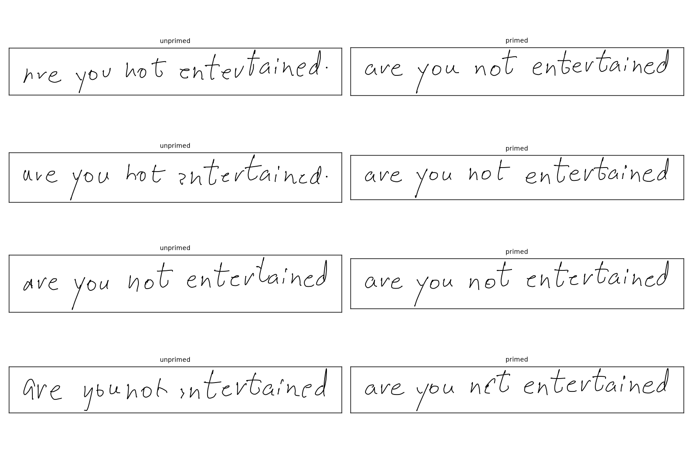
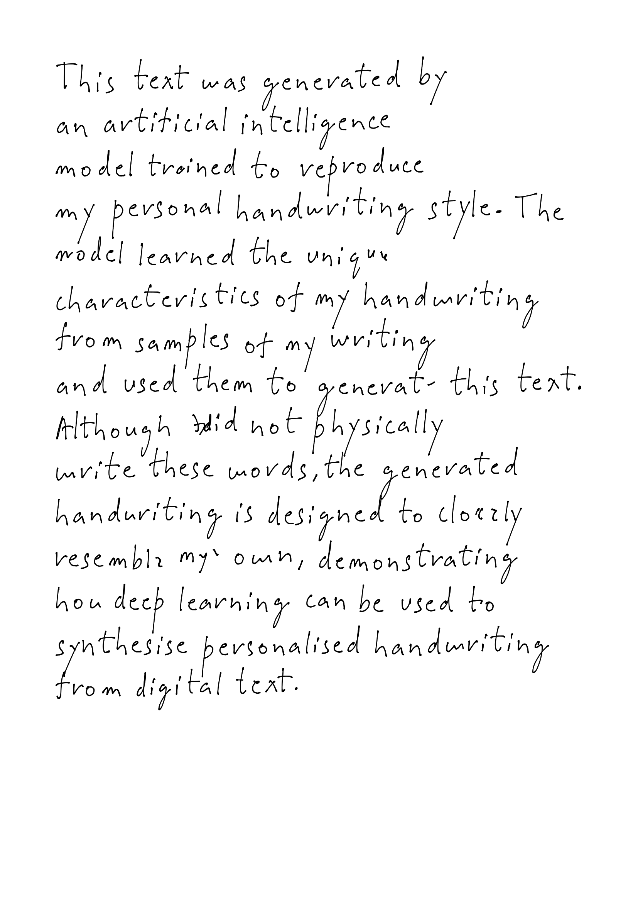

# Personalised Handwriting Synthesis

A handwriting synthesis system built from scratch in PyTorch. It takes typed text and writes it out as pen strokes in a specific person's handwriting, then renders the result as a page image. It includes an LSTM + attention + Mixture Density Network model, a pen capture tool, a data conversion pipeline, fine tuning, style priming, and a page renderer with a Streamlit UI.

## Overview

The model generates handwriting as a sequence of pen movements, not as pixels. Each step it predicts a probability distribution over the next pen offset `(dx, dy)` and whether the pen lifts. Sampling from that distribution is what gives natural variation as the same letter is never drawn identically twice.

The pipeline has four stages:

1. **Pretraining** on the public DeepWriting dataset (294 writers), so the model learns how handwriting moves and how to follow text.
2. **Capture** of the target person's handwriting with a pen tablet, using a Streamlit app with a custom Pointer Events canvas.
3. **Fine-tuning** the pretrained model on the captured lines at a low learning rate.
4. **Generation**: the text is split into short chunks, each chunk is generated after priming the model with a real sample of the person's handwriting, and the chunks are laid out and drawn on a page.

## Project Structure

```
src/
  config.py           Paths and shared hyperparameters
  vocab.py            Character vocabulary: build, encode, decode
  dataset.py          Dataset, padded collate_fn with masks, length bucketed batch sampler
  mdn.py              MDN output head and mixture negative log likelihood loss
  attention.py        Gaussian mixture attention window over the input text
  model.py            Full model: 3 stacked LSTM cells + attention + MDN head
  train.py            Pretraining loop, validation, checkpointing, periodic sample images
  finetune.py         Fine-tuning on personal data with early stopping
  sample.py           Unprimed sampling, stroke plotting, Catmull-Rom smoothing
  prime.py            Priming: run a real handwriting sample through the model, then generate
  layout.py           Text wrapping into chunks, best-of-N generation
  render.py           Page renderer: chunk packing, ink width, PNG and SVG output
  app.py              Streamlit generator UI
  test_samples.py     Grid of generated samples plus attention heatmaps
  prime_test.py       Primed vs unprimed comparison
  capture/
    capture_app.py    Streamlit capture app
    component/
      index.html      Pointer Events canvas that records strokes
    prompts.txt       Lines to write during capture
    check_prompts.py  Validates prompts against the vocabulary
    convert.py        Converts raw captures into the model's training format
dataset/              DeepWriting .npz files (not included)
personal_data/        lines.jsonl (raw captures) and personal.npz (converted)
checkpoints/          Saved weights (not included)
outputs/              Generated images
```

## Features

**Model**

- Three stacked `LSTMCell` layers with skip connections from the input and the attention window to every layer
- Gaussian-mixture attention window: `K` one-dimensional Gaussians over the character positions, with a position that only moves forward
- MDN output head: a mixture of `M` bivariate Gaussians for `(dx, dy)` plus a Bernoulli pen-lift probability
- Loss computed in log space with `logsumexp`, masked over padded timesteps

**Training**

- Input/target shift: the model sees point `t` and predicts point `t+1`
- Length cap and a length-bucketed batch sampler to cut padding waste
- Gradient clipping, and skipping of any batch with a non-finite loss or gradient
- Resumable checkpoints that store model, optimizer, epoch and best validation loss

**Capture**

- Streamlit app with a custom canvas using the Pointer Events API
- Records `(x, y, pressure, timestamp)` for every point, using coalesced events for full pen sample rate
- Guide lines for letter size and baseline, undo/clear, and progress saved after every line

**Data Conversion**

- Resamples strokes at a fixed time interval so the point density matches DeepWriting
- Applies one global scale so letter size matches DeepWriting
- Converts to normalized offsets using DeepWriting's own mean and standard deviation

**Generation**

- Priming: a real line of the person's handwriting is fed through the model first, so its state starts in their style
- Temperature control over mixture choice and spread
- Best-of-N: several attempts per chunk, keeping the one that finished properly and has a natural pace
- Text wrapping into short chunks, packed left to right into rows

**Rendering**

- A4 page with margins, a small random tilt per row and baseline wobble per chunk
- Catmull-Rom spline smoothing through the generated points
- Pen width driven by stroke speed (slow is thicker)
- PNG and SVG output

## Usage

### Requirements

```bash
pip install torch numpy matplotlib streamlit
```

Python 3.12 was used. Training ran on Apple Silicon (`mps`); the code falls back to CUDA or CPU.

### 1. Get the DeepWriting data

Download `deepwriting_training.npz` and `deepwriting_validation.npz` from the DeepWriting project (see References) and place them in `dataset/`.

### 2. Pretrain

```bash
cd src
python3 train.py
```

Training resumes from `checkpoints/resume.pt` if it exists. When it finishes, copy the best weights to keep as the base model:

```bash
cp ../checkpoints/best.pt ../checkpoints/base_pretrained.pt
```

### 3. Capture your handwriting

```bash
cd src/capture
streamlit run capture_app.py
```

Write each prompted line with the pen. Lines are appended to `personal_data/lines.jsonl`, and the app resumes at the next unwritten prompt. Keep letter size and writing speed consistent throughout.

### 4. Convert

```bash
cd src/capture
python3 convert.py
```

Set `DT` (the resampling interval) to the value whose points-per-character is closest to the DeepWriting target that the script prints. The script prints its statistics and writes check plots to `outputs/`.

### 5. Fine-tune

```bash
cd src
python3 finetune.py
```

Starts from `base_pretrained.pt`, holds out about 10% of the lines for validation, and saves the best checkpoint to `checkpoints/personal_best.pt`.

### 6. Generate

```bash
cd src
streamlit run app.py
```

Type or paste text, choose a style sample, and press Generate. The sidebar controls temperature, tries per chunk, chunk length and the layout seed. Pages can be downloaded as PNG or SVG. Changing the layout seed re-lays out the page without regenerating the text.

To render from a script instead, run `python3 render.py`.

## Results

### Pretraining (DeepWriting)

#### Configuration

| Parameter        | Value                                    |
| ---------------- | ---------------------------------------- |
| Dataset          | DeepWriting, lines of at most 400 points |
| Training samples | 29,712 of 34,577                         |
| Validation       | 593 of 705 lines                         |
| Optimizer        | Adam                                     |

#### Metrics

| Metric                        | Value       |
| ----------------------------- | ----------- |
| Train loss (NLL per timestep) | about -2.57 |
| Validation loss               | about -2.55 |

Negative values are expected: the position loss is the negative log of a probability density, and a tight Gaussian can have a density above 1.

### Fine-tuning (personal data)

#### Configuration

| Parameter      | Value                               |
| -------------- | ----------------------------------- |
| Captured lines | TODO: total after the extra prompts |
| Validation     | about 10% of lines                  |
| Learning rate  | 1e-4                                |
| Early stopping | patience of 10 epochs               |

#### Metrics

| Metric                       | Value |
| ---------------------------- | ----- |
| Base model on your val lines | TODO  |
| Best fine-tuned val loss     | TODO  |

#### Visualizations

##### Primed vs Unprimed



##### Generated Page



## Data Format

Captured lines are stored as JSON Lines, one object per line:

```json
{"text": "the quick brown fox", "width": 900, "height": 240,
 "pointer_type": "pen",
 "strokes": [[[x, y, pressure, time_ms], ...], ...]}
```

`convert.py` turns them into the same format as DeepWriting: for each line, an array of rows `[dx, dy, pen]` where `dx` and `dy` are offsets normalized with DeepWriting's mean and standard deviation, and `pen` is `1` on the last point of a stroke and `0` elsewhere. Pressure is stored separately and is only used by the renderer, not the model.

The DeepWriting `char_labels` are not indices into the `alphabet` array. They were produced by a label encoder, so they index into the alphabet in sorted order. `vocab.py` builds the vocabulary that way, and a literal space maps to the empty-string token.

## Hyperparameters

| Parameter     | Description                       | Default                                |
| ------------- | --------------------------------- | -------------------------------------- |
| `hidden_size` | LSTM hidden units per layer       | `256`                                  |
| `K`           | Gaussians in the attention window | `10`                                   |
| `M`           | Mixture components in the MDN     | `20`                                   |
| `vocab_size`  | Characters in the vocabulary      | `70`                                   |
| `MAX_LEN`     | Longest training line, in points  | `400`                                  |
| `LR`          | Pretraining learning rate         | `3e-4`, lowered to `1e-4` when resumed |
| `FT_LR`       | Fine-tuning learning rate         | `1e-4`                                 |
| `CLIP`        | Gradient norm clip                | `10.0`                                 |
| `temp`        | Sampling temperature              | `0.25`                                 |
| `tries`       | Attempts per chunk in best-of-N   | `6`                                    |
| `max_chars`   | Characters per generated chunk    | `14`                                   |

## Dependencies

- `torch`: model, training and sampling
- `numpy`: stroke data processing
- `matplotlib`: plots and page rendering
- `streamlit`: capture and generator UIs

## Limitations

- The model generates strokes, not pressure, so pen width on the page is derived from stroke speed and is only an approximation of ink.
- Only characters in the vocabulary are supported: letters, digits and `' . , - ( ) /`. Characters like `? ! : ;` and curly quotes are replaced with something close or dropped.
- The model was trained on short lines, so text is split into short chunks and re-primed for each one. Chunk joins can look slightly uneven.
- Output is random, so some chunks contain wrong letters. Best-of-N reduces this but cannot read what it wrote. The letter `w` was the most common error in my tests.
- Quality depends on how consistent the captured data is. Mixing letter sizes or writing speeds during capture cannot be fixed afterwards.

## Notes

- The architecture follows Graves (2013), with the DeepWriting dataset for pretraining.
- The attention position increment is divided by 25 at initialization, so the attention starts out moving at roughly the pace of real writing.
- Generation stops when the attention peaks on one extra empty slot appended after the text, then continues until the pen lifts so the last letter is finished.
- Raw captures keep timestamps, so the resampling interval can be changed without recapturing.

## References

- [Generating Sequences With Recurrent Neural Networks, Alex Graves](https://arxiv.org/abs/1308.0850)
- [DeepWriting: Making Digital Ink Editable via Deep Generative Modeling, Aksan et al.](https://arxiv.org/abs/1801.08379)
- [DeepWriting code and dataset](https://github.com/emreaksan/deepwriting)
